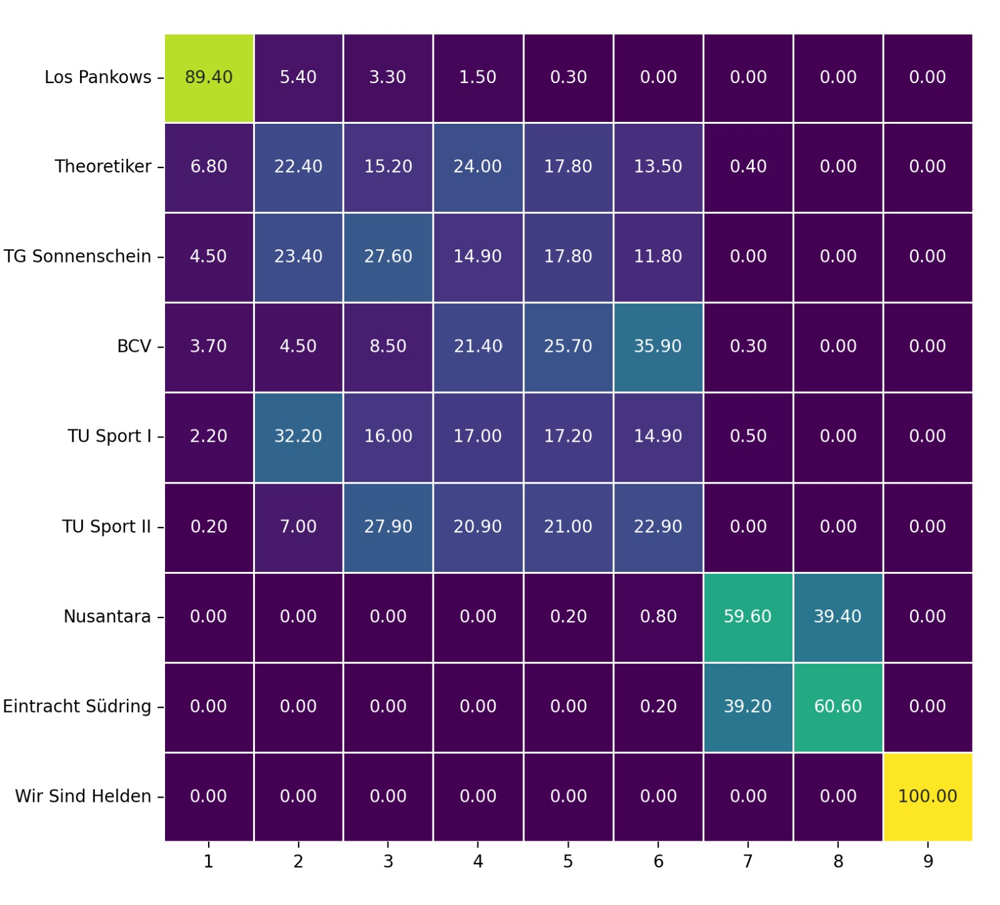

# SeasonSimulation

Simulation of the TU Volleyball league (work in progress)
Given past results, calculate the strength of the teams and simulate the rest of the season.
Underlying model/assumption: each team has a strength rating s which sum to 9 over all teams,
rallies are won by team 1 with probability s_1/(s_1+s_2). Table for the example Season:

Possible TODOs:
Make Simulation more efficient 
Introduce more ranking-criteria so that draws are rarer - maybe adapt position calculation
Comparison of placements for two teams on a grid with probabilities
Final 4 simulation
Easy Way to enter assumptions and existing results for some arbitrary league (first Tests in EnterData)
Easy Way to change rulesets - e.g. 5 set-games or football games -> Bundesliga